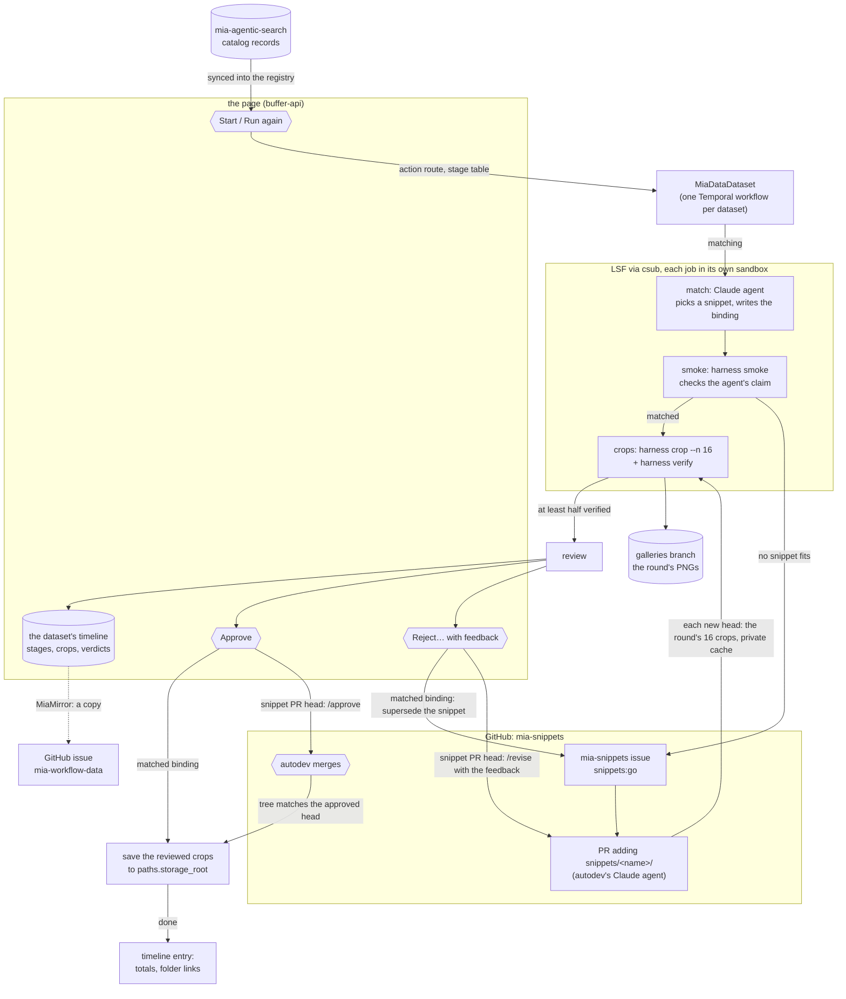

# The mia-data workflow

How a dataset in the MIA catalog becomes a set of verified, saved image crops, and which component does
each step. The setup checklist is the mia-data section of [`docs/autodev-runbook.md`](autodev-runbook.md); the
registry, the action routes and the page are described in [`docs/development.md`](development.md).



## Overview

Every record of the synced [mia-agentic-search](https://github.com/AI-HHMI/mia-agentic-search) catalog is a row on
the page's Datasets tab. A person starts work on one with *Start* on its page, or a preparation request starts
several. From there a durable [Temporal](https://temporal.io) workflow owns the dataset: it runs cluster jobs,
writes each result to the dataset's timeline, and waits, for hours or days, for a person to approve before
anything is saved. The result is a folder of 256×256 PNG crops per dataset, with matching label overlays,
verified by a job that runs no snippet code, and a registry row that says the dataset is `prepared`.

The pieces, and where they live:

| component | repo | role |
|---|---|---|
| `mia_data/` package, `mia-data` CLI (`pixi run mia exec mia-data ...`) | [mia-workflows](https://github.com/JaneliaSciComp/mia-workflows) (this repo) | the workflow, its activities, the poll of snippet PRs, the mirror and devops commands |
| buffer-api and its page | this repo (`mia_buffers/`) | the registry (each dataset's stage, timeline and actions), the action routes behind the page's buttons, and the page itself |
| `autodev/` package | this repo | GitHub client and App auth, the csub job runner, the await-queue pattern; also the agent that writes new snippets |
| snippets and harness | [mia-snippets](https://github.com/JaneliaSciComp/mia-snippets) | one small immutable reader per source format, and the `harness` CLI (`smoke`, `crop`, `verify`, `preview`) |
| issue copies and galleries | [mia-workflow-data](https://github.com/JaneliaSciComp/mia-workflow-data) | one issue per dataset holding a copy of its timeline, written by the mirror and read by nothing; a `galleries` branch of PNGs for review |
| catalog | [mia-agentic-search](https://github.com/AI-HHMI/mia-agentic-search) | dataset records on `main`; read-only here |
| job submission | [csub](https://github.com/krokicki/csub) | submits each job to LSF through a broker that enforces the service account's policy: allowed hosts, roots, agents |
| sandboxing | [agentic-sandbox](https://github.com/JaneliaSciComp/agentic-sandbox) | wraps the worker and every job: read-only code, read-write only its own directories, a network allowlist |
| orchestration | [Temporal](https://temporal.io) | one dev server shared with autodev; namespace `mia-data`, task queues `mia-data` and `mia-data-await` |
| folder links | [Fileglancer](https://github.com/JaneliaSciComp/fileglancer) | timeline entries link the round's workspace and the dataset's crops folder when `paths.*.url` is set |

## The steps

### 1. Start

*Start* on a dataset's page (`#datasets/<record>`) is a `go` sent to buffer-api's action route. The service
checks it against the dataset's stage (`STAGE_ACTIONS` in `mia_data/config.py`), creates the dataset's subject on
its first `go`, records the action and starts the dataset's `MiaDataDataset` workflow with the action as its
signal. A preparation request (*Prepare these datasets*) sends the same `go` for each of its datasets, with the
worker token, and is charged for their jobs. Preparation judges nothing about who may use a dataset: licence and
size are a buffer spec's filters, so a GPL dataset or one of 60-pixel images is prepared like any other. A round
in progress accepts only *Cancel the round*. Components: the page, buffer-api, Temporal.

The round pins the record at the catalog's commit: the commit in the catalog's downloads state when the record
has an entry there, else the head of `main`.

### 2. Match

The workflow sets the stage `matching` and submits the **match job**: a Claude agent, run through csub in a
sandbox with the record, its downloads entry when the catalog has one, a read-only snapshot of mia-snippets at
a pinned commit and the harness CLI. It picks a
snippet for each raw and label array and writes a **binding**, a small YAML saying which files to read with which
snippet and parameters, with reasons. It may run `harness smoke` to try bindings and `harness list` to see a
directory URL's files, but may not change snippet code. The job runs Claude Code restricted to five built-in
tools, with no settings files and no MCP servers; the sandbox mounts are the other half of that restriction. Its
outcome is `matched`, `needs_snippet` or `blocked`.

The worker never trusts the agent's claim. It checks the binding (right record and commit, URLs from the
record, https only, snippets exist) and runs its own **smoke job**, a plain `harness smoke` with no agent. Only
if both agree does the round continue. Components: `autodev.jobs` (the csub runner), csub broker and LSF,
agentic-sandbox, the harness from mia-snippets.

The smoke job writes the record's raw download cache (`paths.work_root/_cache/<record>`), so the worker first
takes the record's **raw lock**, the lock file `paths.local_root/locks/raw/<record>` with the owner
`mia-data <round> smoke`. The wait for the job heartbeats it (TTL 900 s) and the lock is released after the smoke
report is read, whatever it says. When another job holds it (a buffers stage or fetch, another round), the
timeline gets one entry per round, ``waiting for the raw cache of `<record>`: held by <owner>``, and the workflow
tries again every `temporal.poll_minutes`. After the smoke report the worker puts the cache's `raw` asset row
(files, bytes, `ready` or `partial`, `last_used`) to buffer-api. The match agent mounts no writable cache and
takes no lock.

### 3. Develop (only when no snippet fits)

When the agent answers `needs_snippet`, the worker opens an issue in mia-snippets labelled `snippets:go`, with
the draft binding and what failed. A second autodev deployment, `snippets`, turns that issue into a PR adding
`snippets/<name>/` and an example binding. The dataset sits in `developing` and wakes up whenever the PR changes:
`MiaDataPoll`, a Temporal schedule, looks at the snippets repo's pull requests and signals the dataset whose PR
moved. Every new PR head gets the round's crops (step 4), made by an untrusted job with a private cache, and a
required `mia-data/crops` commit status on that exact commit. A head whose crops pass goes to `review` like a
matched binding's; one whose crops fail gets the report as a `/revise` on the PR, and autodev fixes it. Nobody
merges the PR by hand: *Approve* on the dataset's page makes the worker post `/approve <head>` on the PR (stage
`merging`), autodev merges, and if the merged snippet tree is the approved head's, the approved crops are
saved; otherwise the merge commit gets its own crops, reviewed again. If the round ends in `needs-human`
while the PR is still open (a lost job, a failed status write), *Run again* resumes that PR: the current head is
tested again under a new round, and no second snippets issue is opened. A PR closed or merged by then means a new
match. Components: autodev (its own namespace; the two workflows interact only through GitHub, and autodev takes
`/approve` and `/revise` from the worker because its login is in autodev's `github.trusted_bots`), mia-snippets
CI, the GitHub client.

### 4. Crops, review and saving

One set of crops per round. Two plain jobs at the pinned snippets commit: `harness crop --n 16`
(`crops.per_round`) with the round's seed and `--existing` pointing at the dataset's current manifest, so a later
round adds crops rather than duplicating them; then `harness verify` and `harness preview` in a separate
workspace that loads no snippet code. Verify checks each crop is a square 16-bit PNG of the crop edge (256, or
the image's own extent when it is smaller: a small dataset is cropped whole, never refused) with matching labels
and writes overlay PNGs. At least half of the set must verify (verify exits 1 whenever one crop fails, so its
report is the judge); fewer ends the round `needs-human` with nothing saved. The passing crops' `raw.png`
and `overlay.png` are committed to the `galleries` branch of mia-workflow-data, and a timeline entry shows them
with the binding and the agent's reasons. The stage is `review`, and the dataset is listed under *Needs you*.

**The crop judge (shadow).** With `judge.crops.mode: shadow`, a second model looks at the same set before the
person does: the worker builds an evidence directory under the round's workspace (`judge-crops-1/evidence/`: the
question, every verified crop's raw and overlay PNG, `verify.json`, the binding without the agent's reasons, the
record) and runs a read-only Claude Code job over it, budgeted against the root like the match agent. Its verdict
is written as an assessment `by: judge` on the same subject the person's verdict will use, and posted as a second
entry under the crop table (verdict, findings per crop, confidence, model, prompt version, spend, and the line
that it decides nothing). A judge job that fails leaves a one-line entry instead. The dataset still waits at
`review` for the person; the Decisions tab shows the agreement. `mode: off` skips all of it; `mode: active` is
not available.

**Validation.** A person approves the set with *Approve* on the dataset's page, or rejects it with *Reject…*,
which opens a dialog for the feedback. Either verdict carries the revision the page was showing, and buffer-api
refuses one about a set that is not the newest. The verdict is recorded as an assessment in the registry (`by:
human:<who>`), and the save is authorized from the assessments on record, never from the click alone. On
a reject the feedback goes to the agent: as `/revise` on the snippet PR when the round is following one, else in
a new mia-snippets issue asking autodev to supersede the binding's snippet (a merged snippet is never edited).
The next crops come back to `review`; the loop runs until an approve.

**Revocation.** *Revoke* on the dataset's page, once it has saved crops, withdraws them: a `reject`
assessment supersedes the approve, every staged artifact of the record is quarantined and rejected, the registry
row becomes `revoked` and `revoked.json` is written beside the manifest, so no buffer plans or reuses the dataset
and the buffers that drew from it unregister its volumes (the keeper tells them). Nothing is deleted; the dataset
ends in `needs-human` listing the artifacts and buffers, and *Run again* with a round that saves its crops repairs
it.

**Saving.** The approve saves the very crops that were reviewed: the worker reads the round's verify
report back from its workspaces and copies every crop that passed into `paths.storage_root/<dataset>/<crop_id>/`
by an idempotent activity (a retry never duplicates or overwrites), beside `binding.yaml`, and
rebuilds the dataset's `manifest.json`. The final entry carries the totals and links to the crops folder, its
gallery and the round's workspace. The stage is `done` and the registry row `prepared`; *Run again* later starts
another round and adds more crops.

The trusted crop job holds the record's raw lock as in step 2, owner `mia-data <round> crop`, from before the
crop job until its verify report is read, and puts the `raw` asset row afterwards; a PR head's crop job mounts
the cache read-only, writes a private one and takes no lock.

## How the timeline reads

Every stage change is a new entry, never an edit: the stage, what it produced, and the folders to look at. The
dataset is in exactly one stage at a time, written only by the workflow: `matching`, `developing`, `testing`,
`review`, `merging`, `done`, `needs-human` or `cancelled`. The buttons on its page are the actions its stage
accepts. Anything the system cannot handle ends in `needs-human` with an entry saying why and what to change;
*Run again* afterwards retries from the start with a new seed, or, when the round was following a snippet PR that
is still open, picks that PR up again. *Cancel the round* ends a round in progress: its jobs are killed and the
stage is `cancelled`.

The `MiaMirror` workflow copies each entry to the dataset's GitHub issue as a comment and sets the stage as the
issue's `data:<stage>` label. Nothing done to the issue reaches the system.

## The registry hears every stage

`set_stage` writes the subject's stage, its timeline entry and the dataset's row (`PUT /datasets/<record>`), and
the workflow waits for the write: the registry's stage is what buffer-api checks an action against. `prepared`
means `binding.yaml` plus a `manifest.json` whose binding hash matches it; before that a dataset is `in-progress`
or `needs-human`. `mia-buffers datasets sync` rebuilds the prepared rows from `storage_root`.

## Trust boundaries in one paragraph

Agents never hold GitHub credentials or reach GitHub; the worker does every GitHub write. Each job asks csub
only for the hosts in its binding, and the broker's policy is the ceiling: a host missing from the policy fails
the round before submission, with an entry naming it (a person can approve the host from the page when starting
the run). Unreviewed snippet code from a PR head runs only inside
job sandboxes, and the verify job that judges its output loads no snippet code. Merging a snippet needs a
person's approve of the crops its exact head made, plus the required status; so does saving them. The page's
buttons need no login: they can ask the workflow to act, and cannot write what a workflow found.

## Operating it

```
pixi run mia exec mia-data check    # repos, Temporal, csub policy, directories, harness pin
pixi run mia up                     # Temporal, then every service in mia.yaml; or: mia up mia-data
pixi run mia ps | logs mia-data -f | attach mia-data | down mia-data | restart mia-data
pixi run mia exec mia-data init-labels   # the stage labels the mirror sets on the issue copies
```

`mia pause` stops every round at its next job (after `mia resume`, press the button again); every job is first
reserved against its root request's caps in `autonomy.root`, and a refusal ends the round naming the cap. Config
is the `mia-data` block of `mia.yaml` (see `mia.yaml.example`). `paths.work_root` and `paths.storage_root` take
a path or `{path, url}`; with a Fileglancer URL the entries link the folders they mention.
